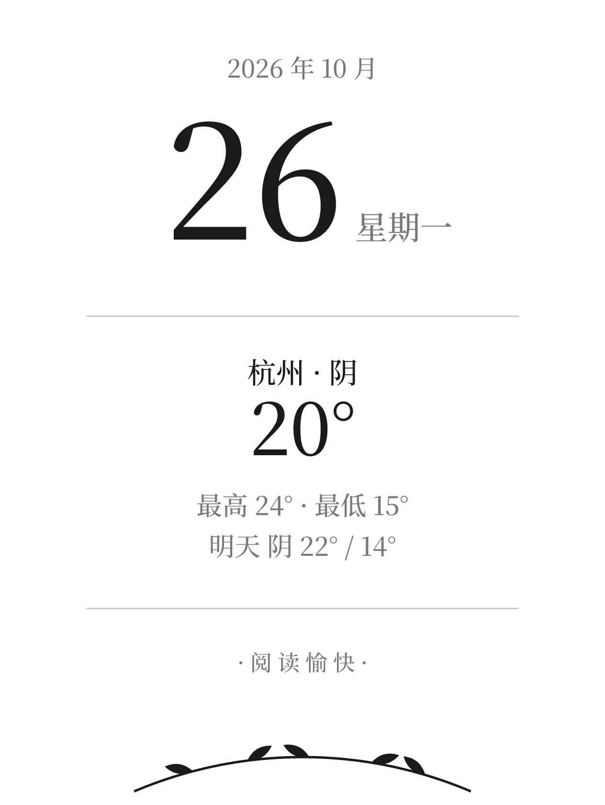
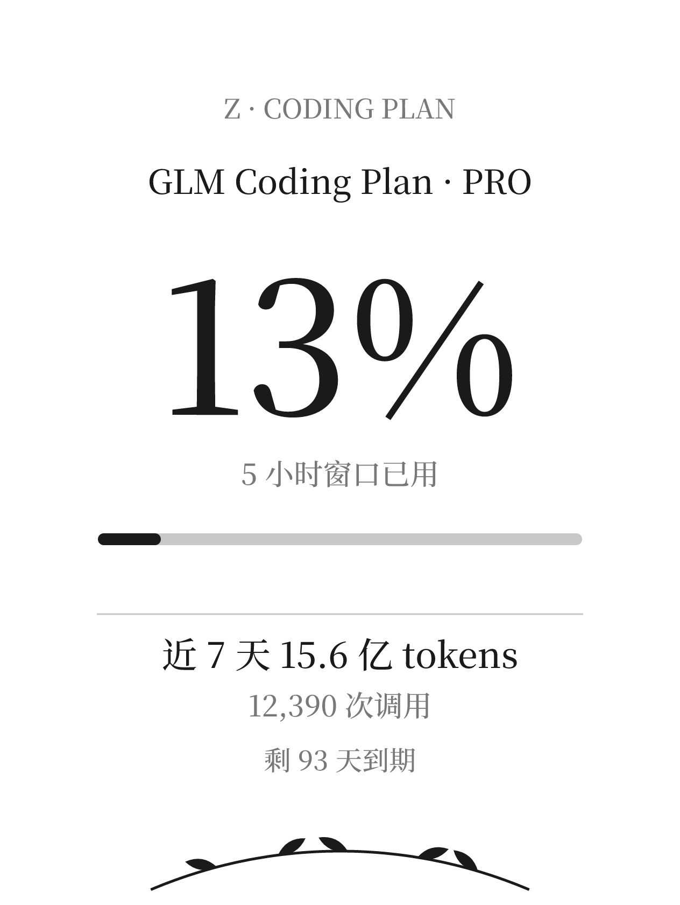
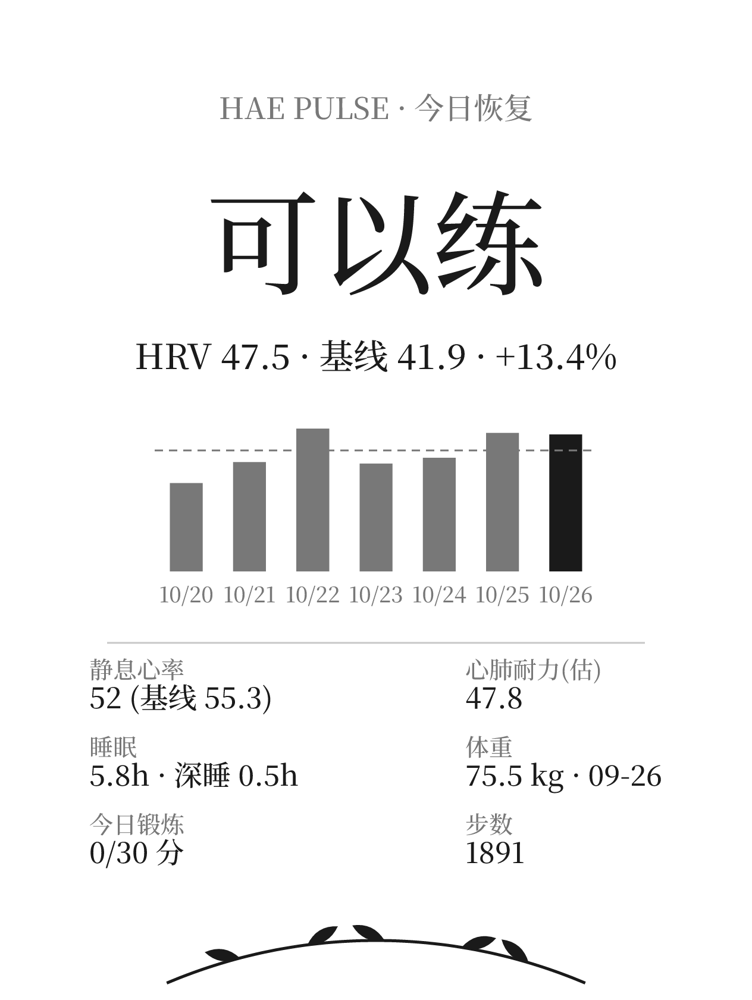
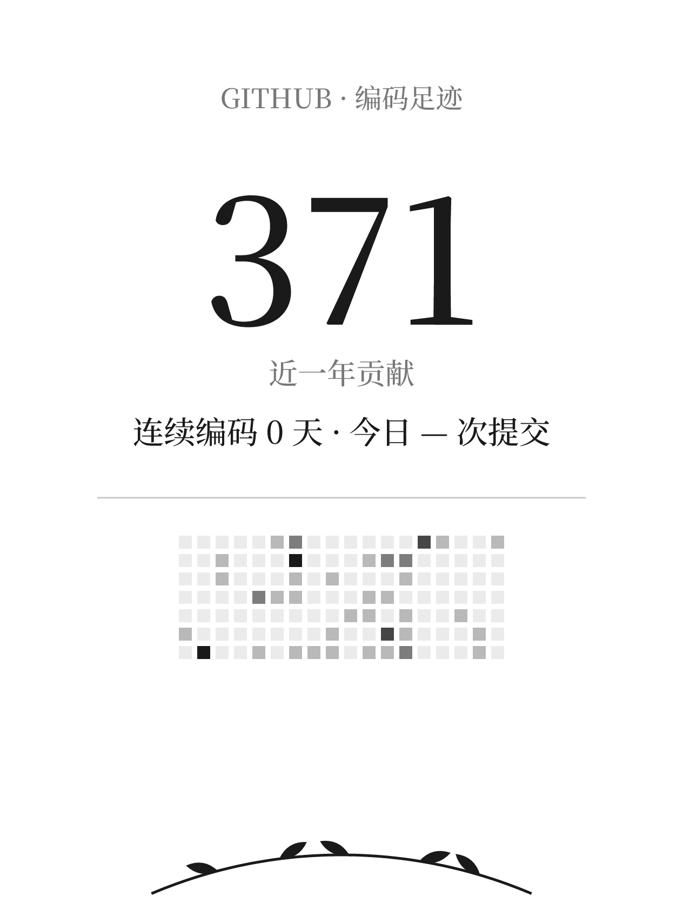

# boox-standby

把文石 **BOOX** 电纸书的待机（息屏）画面变成一个**完全独立运行**的墨水屏信息站：随机轮播四页内容——

| 页 | 内容 | 数据源 |
|---|---|---|
| 1 | 日历 + 天气 + 明日预报 | [Open-Meteo](https://open-meteo.com) |
| 2 | GLM Coding Plan 用量（5 小时窗口 + 近 7 天 + 到期提醒） | [Z.ai](https://z.ai) |
| 3 | 健康恢复（HRV / 静息心率 / 睡眠 / 锻炼，含「可以练 / 悠着点 / 该休息」判定） | [Health Auto Export](https://healthyapis.com) |
| 4 | GitHub 编码足迹（近一年贡献 + 连续天数 + 18 周热力图） | github.com 公开页面 |

每 30 分钟设备自动换一页（随机），每 4 小时数据全量刷新。**电脑关机、离家、出差，都不影响。**

| 页1 日历天气 | 页2 用量 | 页3 健康 | 页4 GitHub |
|---|---|---|---|
|  |  |  |  |

## 架构

```
┌─ Cloudflare Worker（每 4 小时 Cron）
│    抓取四路数据 → 手写 SVG → resvg-wasm 转 PNG → 存 KV
│    对外端点: /random.png · /page1-4.png · GET / · POST /refresh
│    ⚠️ 必须绑定自定义域名 —— workers.dev 在中国大陆不可达
│
└─ BOOX 设备上的 Termux（每 30 分钟）
     curl 拉 /random.png → am broadcast 设为待机画面
     Termux:Boot 开机自启 · termux-wake-lock 保活
```

设计要点：

- **设备零密钥**：Z.ai / HAE 的 API key 只存在 Worker Secrets 里，设备只下载渲染好的 PNG
- **零打扰**：改图只替换"下次休眠要渲染的文件"，从不唤醒屏幕
- **免 root**：核心机制是 BOOX 的公开广播 `onyx.action.SCREENSAVER`（type 16），普通 App 身份即可调用
- **黑白屏友好**：全部灰度设计，Noto Serif CJK 子集字体（~115KB/字重）

实测机型：**BOOX Leaf3**（国行，Android 11）。理论上适配所有能装 Termux 的 BOOX 机型。

## 部署

### 一、Cloudflare Worker

```bash
npm install
# 1. 创建 KV 并上传字体 / wasm
cf kv namespaces create --title boox-standby
#    → 把返回的 id 填进 cloudflare.config.ts
pyftsubset /usr/share/fonts/noto-cjk/NotoSerifCJK-Light.ttc  --font-number=2 \
  --text-file=glyphs.txt --output-file=fonts/serif-light.ttf  --name-IDs='*' --glyph-names
pyftsubset /usr/share/fonts/noto-cjk/NotoSerifCJK-Medium.ttc --font-number=2 \
  --text-file=glyphs.txt --output-file=fonts/serif-medium.ttf --name-IDs='*' --glyph-names
cf kv keys put font-light  --namespace-id <NS_ID> --file fonts/serif-light.ttf
cf kv keys put font-medium --namespace-id <NS_ID> --file fonts/serif-medium.ttf
cf kv keys put resvg.wasm  --namespace-id <NS_ID> --file node_modules/@resvg/resvg-wasm/index_bg.wasm

# 2. secrets
openssl rand -hex 16 > .secrets   # 首行改成 CRON_TOKEN=<值>，并补齐另外两个
cf deploy --secrets-file .secrets

# 3. 绑定自定义域名（API 方式；workers.dev 国内不可达）
curl -X PUT -H "Authorization: Bearer <CF_TOKEN>" -H "Content-Type: application/json" \
  "https://api.cloudflare.com/client/v4/accounts/<ACCOUNT_ID>/workers/domains" \
  -d '{"zone_id":"<ZONE_ID>","hostname":"boox.example.com","service":"boox-standby-ws","environment":"production"}'
```

`cloudflare.config.ts` 里的变量按需修改：`CITY` / `LAT` / `LON`（天气）、`GITHUB_USER`、`EXPIRE_DATE`（套餐到期提醒）。

### 二、BOOX 设备（Termux）

1. 安装 **Termux**（F-Droid 版）与 **Termux:Boot**，各打开一次
2. `pkg install curl`
3. 把 [`termux/boox-standby.sh`](termux/boox-standby.sh) 放到 `~/.termux/boot/`（开机自启）并 `chmod +x`，手动先跑一次：`sh ~/.termux/boot/boox-standby.sh &`
4. BOOX 设置 → 应用管理 → Termux → 开启「自启动」（防休眠冻结）

> 需要在设备的网络里可达你的 Worker 域名；`/sdcard/Android/data/com.termux/files/` 是 Termux 免授权可写、系统进程可读的目录，正好用来中转 PNG。

## 配置项

| 位置 | 键 | 说明 |
|---|---|---|
| Worker Secrets | `ZAI_API_KEY` / `HAE_READ_KEY` / `CRON_TOKEN` | 数据源与刷新令牌 |
| cloudflare.config.ts | `CITY` `LAT` `LON` | 天气城市（建议手动指定，IP 定位会漂） |
| cloudflare.config.ts | `GITHUB_USER` | 编码足迹的账号 |
| cloudflare.config.ts | `EXPIRE_DATE` | Coding Plan 到期日，页 2 自动显示剩余天数 |

手动立刻刷新：`curl -X POST -H "X-Token: <CRON_TOKEN>" https://你的域名/refresh`

## 踩坑记录（BOOX / Workers 特供）

- BOOX 固件**没有**「连点版本号进开发者选项」，USB 调试藏在 设置 → 应用 → 应用管理
- 待机画面只在设备**进入休眠的瞬间**渲染；`Broadcast completed: result=0` 只代表广播送达
- workerd 禁止从字节数组实例化 wasm —— resvg 必须走**编译期模块导入**，不能从 KV 拉
- resvg 的 `fontBuffers` 只认 `Uint8Array`（传 `ArrayBuffer` 会抛出一个神秘 ArrayBuffer）
- CJK 字体务必**按实际用字做子集**，且字符集要从渲染源码全文提取（漏一个字就渲染成空白）
- github.com 对部分非浏览器 TLS 指纹（如 python-urllib）直接拖死连接，用 curl 或在 Worker 里 fetch 都没事

## 致谢

- [boox-standby-token-usage](https://github.com/LeaiFish/boox-standby-token-usage) —— `onyx.action.SCREENSAVER` 广播机制的来源
- [hae-pulse](https://github.com/hongyangchun/hae-pulse) —— 健康数据采集与本页面的判定逻辑同源
- [@resvg/resvg-wasm](https://github.com/nickbabcock/resvg-wasm) · [Noto Serif CJK](https://fonts.google.com/noto)（OFL）
